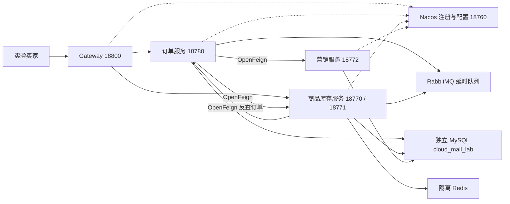

# 阶段 6 · Spring Cloud Alibaba 独立商城实验

## 组件边界

同一个 MySQL 实验库按服务使用 `lab_order`、`stock_*` 和 `marketing_*` 表。服务间通过 HTTP 和 MQ 协作，没有跨服务 SQL 写入。库存实例共享 MySQL；Redis 保存商品名称和价格，库存数每次从数据库读取。业务服务仅监听环回地址，网关只暴露公开商品及订单接口，替换客户端自带的用户和链路标识。这是本机可复现实验，部署到可被远程访问的环境需要独立的身份与网络控制。

## 订单、库存和优惠券

1. 订单服务以用户和 `requestId` 去重，在本地事务插入订单后发起 Feign 库存锁定。库存通过订单编号串行处理工作单，事务内一起扣库存并记录 `LOCKED`。占券保存成交时使用的门槛和面额，金额从商品服务提供的单价计算。
2. 订单事务提交后，持久化的超时任务经发布确认进入 RabbitMQ 延时队列。未支付订单到期后条件更新为 `CLOSED`。取消和关闭由持久任务重试通知库存与营销释放。
3. 库存锁定后安排自己的延时反查，以数据库工作单兜底补跑。只有订单服务明确返回 `MISSING`、`CANCELED` 或 `CLOSED` 才归还。网络失败和仍在支付期分别继续观察。订单服务也有独立提交的回滚反查工作，用于补偿可能已执行但响应丢失的下游写入。
4. 释放按订单幂等，状态从 `LOCKED` 或 `RESERVED` 转为 `RELEASED`，重复消息不增发库存或券。释放先到会留下终态工作单，阻止旧锁定或占券请求晚到时重建占用。

默认订单支付窗口为 4 秒，库存第一次反查在 10 秒后。订单事务和远程超时均有边界。Redis 商品缓存也不参与库存权威判断。

## 聚合与故障策略

同一个详情接口复用三次读取。默认用 `CompletableFuture` 在有界线程池并行读取商品、活动和券，显式将请求线程的 `X-Trace-Id` 带到任务，Feign 再传给目标服务。`mode=serial` 使用相同读路径按顺序调用便于对照。

营销两个读接口独立使用 Sentinel 慢调用比例和异常比例熔断。受影响的字段返回空列表，商品主信息仍可读取，`marketingDegraded` 标记当前响应有降级。营销依赖不足时，用户仍可按原价下单。网关使用 Sentinel 限制订单写路由的 QPS；商品服务的热点规则按商品编号计数。

动态属性在 Nacos 的 `cloud-lab.properties`、`DEFAULT_GROUP` 下统一发布。营销文案、营销故障演练开关和网关 QPS 规则可更新，无需重启 JVM。实验服务本身的就绪和 Nacos 服务发现之间仍有传播窗口。
